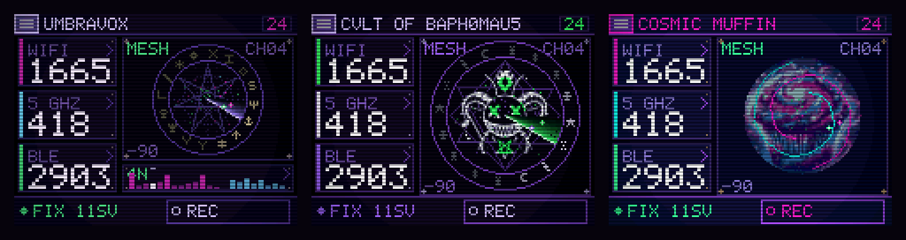

# UMBRAVOX

**A passive, dual-band wardriver for the ESP32-C5 — with a summoning-circle console instead of a dashboard.**



## What it is

UMBRAVOX turns a ~$15 touchscreen dev board into a handheld scanner for the radio
spectrum around you. It listens — WiFi, Bluetooth LE and GPS — deduplicates
everything it hears, maps it, flags the devices worth knowing about (cameras,
trackers, plate readers, drones…), and logs it all to an SD card in
[WiGLE](https://wigle.net/)-compatible CSV you can upload straight to the usual
wardriving maps.

It is **wardriving's passive half**: it only receives. It never transmits,
probes, associates or attacks — it reads what the air is already broadcasting.
Add extra scanning boards over a wireless mesh and it covers more of the spectrum
at once, folding every radio's catch into one deduplicated picture.

And instead of a dashboard, it renders a dark, occult, technomancer interface —
switchable themes, animated dials, a summoning-circle aesthetic.

> ### 🜏 Passive by design
> UMBRAVOX scans, aggregates, maps and exports — nothing more. It deliberately
> ships **none** of the transmit-side offensive tooling: no deauth, beacon/BLE
> spam, Evil Portal, Karma or PMKID capture. It listens; it does not announce
> itself or interfere with anything. Please keep it that way, and check your
> local laws before you go wardriving.

## Features

- **Dual-band WiFi capture** — promiscuous sniffing of management frames (beacons,
  probe responses) across all 13 channels of 2.4 GHz and the 8 non-DFS channels
  of 5 GHz, deduplicated by BSSID.
- **Passive BLE scanning** — advertisers deduplicated by address and parsed by
  hand from the raw advertisement, so it never sends a scan request.
- **GPS mapping** — NMEA fix and satellite tracking geolocate every finding.
- **SD logging** — WiGLE-format CSV, appended to the session file in small
  batches. After a power cut the file keeps every whole line written so far;
  rows not yet flushed, or still held back for a better position (up to about
  2 minutes), are lost. Session files are named `WD-<date>-<time>.csv`
  (`WD-NNNN.csv` before the GPS has given a date), always lowercase, and a
  new file starts at 20,000 APs. A reboot resumes into a new file and never
  touches the old one. Not yet verified on hardware.
- **Threat & point-of-interest alerts** — 162 device signatures (surveillance
  cameras, ALPRs, AirTag / Tile / Find My trackers, Remote ID drones,
  Flipper / pentest gear, card-skimmer modules…), each with its own confidence
  grade so a weak guess stays quiet instead of crying wolf.
  → [the full detection list](docs/detections.md)
- **Optional multi-node mesh** — headless scanning nodes and an optional
  coordinator tier report back wirelessly, isolated per-fleet so neighbouring
  setups never cross-talk.
- **Field diagnostics** — a plain-text `/diag.log` on the card records the reset
  reason and errors, and a `/perf.csv` records how the instrument is running
  (frame cost, stalls, heap, capture and mesh rates), so a problem or a
  slowdown in the field can be sent back as a file.
- **Three themes, on-device** — UMBRAVOX (violet heptagram), CVLT OF BAPH0MAU5
  (a summoning seal) and COSMIC MUFFIN (a neon galaxy-frosted muffin on a
  deep-space dial). Each has its own centrepiece and its own alert: a warding
  circle, a summoning rite, or — on COSMIC MUFFIN — your pick of Supernova,
  Vortex, Comet Strike or Lock-On.
- **Eleven dial sweeps** — radar, gaze, pulse, star and candle, plus six cosmic
  ones (galaxy, orbit, starfall, pulsar, comet, aurora). Sweeps are drawn in
  whichever theme's colours are active, so every theme can use every sweep
  (the gaze needs the seal's eyes, so it stays with BAPH0MAU5).

## Theme packs

You can give UMBRAVOX your own look without a toolchain. A theme pack is a small
data-only folder on the SD card (`/themes/<name>/theme.json`, plus an optional
`emblem.bin`) that sets the colours, the centrepiece picture, the sweeps and the
alert rite. The [theme designer](https://em3ritus.github.io/umbravox/designer/)
builds one with a live preview and can write it to the card; the reference,
including every limit, is [docs/theme-packs.md](docs/theme-packs.md). Packs cannot run
code or touch the radios.

## Hardware

Primary target is the **RockBase NM-CYD-C5** — a "Cheap Yellow Display" for the C5:

| | |
|---|---|
| MCU | ESP32-C5 — single core, dual-band WiFi 6 + BLE 5, 16 MB flash, 8 MB PSRAM |
| Display | 2.8" 320×240 ST7789 |
| Touch | XPT2046 (resistive, polled — no IRQ line) |
| GPS | external NMEA receiver on header P5 (GPIO 4 RX, 9600 baud) |
| Storage | microSD on the shared SPI bus (CS 10) |

Scanning **nodes** and **coordinators** are headless — any ESP32-C5 board works
(Waveshare ESP32-C5 and Seeed XIAO ESP32-C5 are both confirmed). They need only
power and a radio: no display, touch or GPS.

## How it works

**Simulator-first UI.** The look is the risky part, and iterating on it over USB
reflashes is how a project like this dies. The entire interface compiles and runs
on a PC, rendering frames straight to PNG. Device and simulator share one copy of
the UI code and fill the same plain `State` struct (`ui/model.h`) — on the board
a collector fills it from real radios, on the PC it's filled with invented
numbers — so the art can never drift from what the glass actually draws.

**160×120, blitted 1:2 to the panel.** The framebuffer fits in internal SRAM, and
because the C5 is single-core every redraw steals CPU from packet capture. A small
buffer, dirty-rectangle blitting and a dependency-free renderer (`g++` + `make`,
PNGs written without zlib) keep a frame cheap. The chunky-pixel look is a side
effect of that budget, not a filter on top of it.

**The mesh (optional).** One radio sweeping 21 channels visits each only about
once every 5 seconds, so a beacon on a channel you aren't parked on is simply
gone. More radios is the real fix:

```
            nodes ──► coordinator ──┐
            nodes ──► coordinator ──┼──► CYD (collector) ──► screen + SD + WiGLE
            nodes ──────────────────┘
```

- **0 coordinators** — the flat mesh: nodes report straight to the CYD, which
  parks on the report channel whenever a node is present. Fully backward-compatible.
- **1–2 coordinators** — a middle tier that splits the spectrum by band (e.g. one
  owns 2.4 GHz, one owns 5 GHz), each running its own cluster of nodes and folding
  results up to the CYD. Scales toward ~12 co-located nodes; you add one when a
  report channel's loss climbs past ~10–15%.

Transport is **ESP-NOW** (no AP, no association), isolated per-fleet by a network
id you set over the air with an on-screen **ENROLL** button, so two setups in the
same room keep to their own gear. **ENROLL** moves open boards onto your net;
**RESET** stays on the net until every board has left, so none is left behind. If
a board is ever stranded, `NETSET <id>` on the USB console puts the CYD back on a
known net to go and fetch it (details in [docs/design-notes.md](docs/design-notes.md)).
It is otherwise **unauthenticated by design**
(magic + version only) — an encrypted cluster mode is on the roadmap, but
ESP-NOW's encrypted-peer cap fights the node-count goal, so for now treat the mesh
as trusted-RF-range only.

## Getting started

### Simulator (PC) — no hardware needed

Build the UI and render it straight to PNG:

```sh
cd sim
make                               # build the simulator + host tests
./umbravox out.png                 # render one frame (4×, 640×480)
./umbravox out.png --scale 2       # 320×240 — exactly what the panel shows
./umbravox out.png --theme 2       # 0 UMBRAVOX, 1 CVLT OF BAPH0MAU5, 2 COSMIC MUFFIN
./umbravox out.png --sweep 5       # pick a sweep (0-10)
./umbravox out.png --theme 2 --alert 1 --frame 20   # an alert style mid-rite
./umbravox out.png --screen codex  # pick a screen
make test                          # run the host test suite
make regress                       # compare rendered screens to baselines
```

### Flash a board

The easy way is **[flashing from your browser](https://em3ritus.github.io/umbravox/)**
— a desktop Chromium browser (Chrome, Edge, Opera), no toolchain. Or build it
yourself with [PlatformIO](https://platformio.org/) on the
[pioarduino](https://github.com/pioarduino/platform-espressif32) platform (stock
`espressif32` has no ESP32-C5 support):

```sh
pio run -e nm-cyd-c5         -t upload   # the CYD (display + collector)
pio run -e nm-c5-node        -t upload   # a headless scanning node
pio run -e nm-c5-coordinator -t upload   # a coordinator
```

Some C5 boards (WCH-bridge, newer silicon revisions) need `upload_speed = 115200`
and `--no-stub`; details in [docs/design-notes.md](docs/design-notes.md).

### Troubleshooting

The CYD keeps a plain-text diagnostic log at **`/diag.log`** on the card: every
boot records the firmware build and the **reset reason** (so a crash, watchdog or
brownout leaves a fingerprint), plus a line on any SD-write failure or low-heap
event. It caps at ~128 KB and rotates once. If something misbehaves, pull the card
and send `diag.log`, or print it over USB serial with the `DIAG` command (115200
baud).

For performance, **`/perf.csv`** gets one row every 10 seconds: frames per second,
average and worst draw/blit time, the longest stall between loops, free heap and
its low-water mark, capture and mesh rates, and the cost of the SD writes
themselves (written in batches of three rows, so one ~20 ms write per 30 s). It
rotates at 1 MiB. Print it with the `PERF` command, or summarise a file from the
card and see what is worth tuning:

```sh
python3 -I tools/perf_report.py perf.0.csv perf.csv     # oldest first
```

### The USB console

At 115200 baud the CYD answers `TEST`, `WIGLE`, `SDLS [dir]`, `SDCAT <file>`,
`DIAG`, `PERF`, `GPS`, `GPSFIX`, `ENROLL`, `NETRESET` and `NETSET <id>`, and, to
install theme packs without removing the card, `SDPUT`, `SDDEL <path>`,
`SDRMDIR <folder>` and `REBOOT`. Use `tools/sdput.py` for those rather than typing
them (see [Installing over USB](docs/theme-packs.md#installing-over-usb-without-removing-the-card)).
They work on the wired console only, can write nothing but pack files and delete
nothing but pack files and old session logs, and are not yet verified on hardware.

## Project layout

```
ui/            UI + pure logic — compiles for BOTH the PC and the device
  screen_*.cpp   the nine screens (scan, codex, detail, mesh, settings…)
  palette.*      the theme table: colours, dial radii, offered sweeps
  sweep.*        the eleven dial searches   muffinseal.* the muffin centrepiece
  art/           source art the asset generators read
  signatures.*   device-signature matching (host-tested, no hardware)
  gnss.*         NMEA parser (host-tested)
  model.h        State: everything a screen may know
device/        board only — radios, mesh, capture, storage
  main.cpp       CYD firmware: owns the panel, the blit, the collector
  node_main.cpp  headless scanning node          [env:nm-c5-node]
  coord_main.cpp coordinator tier                [env:nm-c5-coordinator]
  capture.*      WiFi sniffing   blescan.* BLE    gpstrack.* GPS
  meshcore.* mesh.h chanplan.h balance.h phase.h rehome.h   the mesh
  sdlog.* elog.* wigle.h csv.h   SD, diagnostics + WiGLE CSV export
sim/           PC only — simulator + host test suite (make test / regress)
docs/          screenshots, detection list, design notes, acceptance runbook
tools/         web-flasher builder, sigil + muffin generators
platformio.ini
```

## Status

Working on real hardware: dual-band capture, BLE, GPS, SD/WiGLE logging, touch
navigation, all three themes, the signature alerts, over-the-air mesh enrollment, and
the mesh in its 0-, 1- and 2-coordinator forms — validated end-to-end
(node → coordinator → CYD → geolocated WiGLE export). The 12-node scale path is
validated in host tests pending a physical fleet; see the
[acceptance runbook](docs/hardware-acceptance-multi-coordinator.md).

## License & credit

GPL-3.0-or-later — see [LICENSE](LICENSE).

The device-signature tables and their confidence grading are derived from
[SquachWatch-CYD](https://github.com/skizzophrenic/SquachWatch-CYD) (GPL-3.0); see
[NOTICE](NOTICE) for details and credit.
