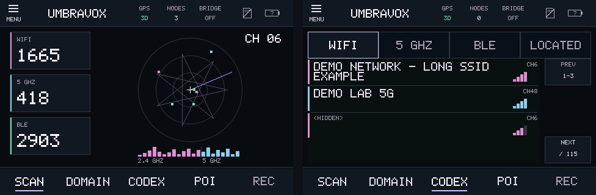

# UMBRAVOX

**RF discovery, wardriving & network exploration for ESP32-C5.**

Discover Wi-Fi and Bluetooth LE devices, inspect networks, map observations,
and save captures for analysis. Run standalone, connect to a phone app, or
expand coverage with coordinated scanning nodes.

[Install in your browser](https://slickrick773.github.io/umbravox/) ·
[Published prerelease and downloads](https://github.com/slickrick773/umbravox/releases/tag/f963f3a)



Stock UMBRAVOX theme, native 480×320 production-renderer previews using synthetic
demonstration data. These are not hardware photographs.

## Boards and validation

| Board | Native UI | Current hardware evidence |
| --- | --- | --- |
| Waveshare ESP32-C5-Touch-LCD-3.5 | 480×320 | Browser installation, all four image hashes, and boot confirmed |
| Waveshare ESP32-C5-Touch-LCD-2.8 | 320×240 | Browser installation, all four image hashes, and boot confirmed |
| NerdMinder NM-CYD-C5 | 320×240 shared engine | Browser installation, all four image hashes, and boot confirmed |

The published firmware packages use `bce092c` for Waveshare and `45e7ed3` for NM.
The prerelease tag `f963f3a` identifies the installer/release source. Subsequent
branch commits correct documentation and CI checks; they do not replace those
published binaries. Each board ZIP includes its matching source snapshot.

## Installation

Use desktop Chrome or Edge, a USB data cable, and the [browser installer](https://slickrick773.github.io/umbravox/).
Select your exact board: Waveshare 3.5″, Waveshare 2.8″, or NM-CYD-C5.
After all four images verify, press RESET without holding BOOT.

First native-UI installation replaces the partition table with two 6 MiB app
slots, including migration from NM's old 3 MiB slot. Back up needed internal
flash data first; existing internal filesystem data may become inaccessible.
External SD is not written. No full-chip erase is performed. OTA is not implemented.

See [Waveshare partitions](docs/WAVESHARE-PARTITIONS.md),
[NM native engine](docs/NM-NATIVE-ENGINE.md), and
[installer details](web/native/README.md).

## Discover and inspect

- **Dual-band Wi-Fi discovery:** scan 2.4 GHz and supported 5 GHz channels, with selectable active/passive scanning and configurable dwell timing. Active mode transmits probe requests; hidden network names are not guaranteed to resolve.
- **Bluetooth LE discovery:** observe nearby advertisements alongside Wi-Fi scanning, with configurable scan allocation.
- **SCAN:** live Wi-Fi/5 GHz/BLE counts, channel activity bars and a theme-aware signal field. The SCAN field visualizes signal activity, not measured direction or distance.
- **CODEX:** browse discovered devices, sort APs by signal strength, and open full AP details including SSID, BSSID, channel, RSSI and security information.
- **Deeper AP details:** vendor/OUI lookup, signal history, first/last observation ages, advertised PHY capabilities and channel width, country, beacon interval and WPS information when available in received frames.
- **DOMAIN:** browse located APs with a geographic view, adjustable range and access to full AP details. Locations require available location evidence; unknown positions are not invented.
- **Clients and probes:** inspect observed station/AP relationships and requested network names. Hidden-name resolution uses captured evidence; a probe alone does not prove association.
- **Alerts:** review signature matches with evidence and confidence, plus a clearly labeled test alert. A vendor or signature match is an indication, not proof of a device's owner or purpose.

## Record and export

- WiGLE-compatible Wi-Fi CSV recordings.
- GPX tracks from valid GPS fixes during recording.
- Client and probe CSV companion files.
- Raw 802.11 PCAP capture for inspection in Wireshark, controlled separately from normal recording.
- A dedicated **POI** action for marking points of interest.
- Organized session and capture folders on SD, with a Files browser, access to legacy recordings, and protection against deleting files that are still in use.

## Connect your phone and nodes

- **WarDriveGo and Biscuit BLE bridge:** stream Wi-Fi observations to the selected phone app. Toggle the bridge from the header; the phone supplies location for its own records. This is not a BLE-device or raw-PCAP export stream.
- **Coordinated scanning nodes:** distribute channel work and configure scanning mode/dwell from the handheld.
- **Nodes diagnostics:** inspect applied versus requested settings, report freshness, queue occupancy/drops and delivery failures.
- Bridge streaming, local scanning and SD recording have separate controls. Stopping recording does not stop discovery.

## Native touchscreen interface

- Native landscape layouts at **480×320** and **320×240**.
- Persistent navigation, scrolling lists and full AP detail pages.
- Header GPS, Nodes, bridge, SD and battery indicators; absent batteries do not display a fabricated charge level.
- Dedicated Scanning, Recording, Bridge and Nodes settings pages.
- Separate display/touch controls for brightness, idle behavior and touch testing.
- Bundled general and crew themes, plus SD theme-pack support. The release screenshots use the stock **UMBRAVOX** theme.

## Scope

Active Wi-Fi scanning transmits probe requests. BLE bridges and node reporting
also transmit; this firmware is not receive-only. Scan mode, recording and bridge
state are separate controls.

Local GPS-dependent recordings need a valid board GPS fix. Phone GPS supplies
the phone app's records and is not assumed to feed back into the board.
Native portrait mode and direct WiGLE / WDG Wars / Wardrift API uploads are not
included. The XIAO ESP32-C5 node is available as a separate download on the
[handheld prerelease](https://github.com/slickrick773/umbravox/releases/tag/f963f3a).
See [XIAO node installation](docs/XIAO-NODE.md) for flashing and enrollment.

## Development

The native UI lives in `ui/`, with device integration under `device/`, host tests
under `sim/`, and the browser installer under `web/native/`.

```sh
make -C sim test
node --test web/native/test/*.test.mjs
bash tools/build-designer-wasm.sh
npm test
```

Designer tests require the Emscripten version pinned in `tools/emsdk-version.txt`.
See [flashing tools](docs/FLASHING-TOOLS.md) for the validated CLI version and
setup. See `platformio.ini` for board-specific build environments. Choose the native
engine target for your board; legacy build targets remain in the source tree.

## License & credit

GPL-3.0-or-later — see [LICENSE](LICENSE).

The device-signature tables and their confidence grading are derived from
[SquachWatch-CYD](https://github.com/skizzophrenic/SquachWatch-CYD) (GPL-3.0); see
[NOTICE](NOTICE) for details and credit.
