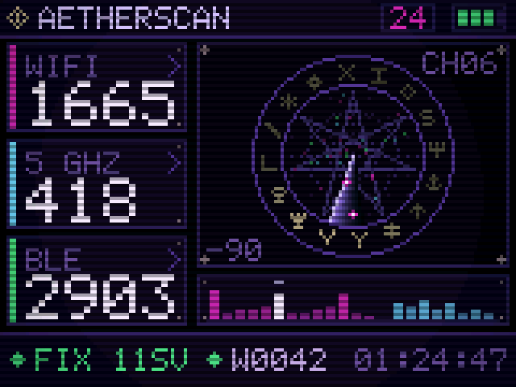

# AETHERSCAN

A **passive, dual-band wardriver** with a dark-technomancer interface, built for
the ESP32-C5. It listens to the radio spectrum around you — WiFi, BLE and GPS —
deduplicates what it hears, maps it, flags devices worth knowing about, and
logs it all to an SD card in [WiGLE](https://wigle.net/)-compatible CSV. Add
scanning nodes over a wireless mesh and it covers more of the spectrum at once.

It runs on a `$15` touchscreen dev board and renders a summoning-circle console
instead of a dashboard.



> **Scope: this is receive-only by design.** AETHERSCAN scans, aggregates,
> maps and exports — the passive half of wardriving. It deliberately ships
> none of the transmit-side offensive tooling (deauth, beacon/BLE spam, Evil
> Portal, Karma, PMKID capture). It listens; it does not announce itself or
> attack anything. Please keep it that way, and check your local laws before
> wardriving.

## What it does

- **Dual-band WiFi capture** — promiscuous sniffing of management frames
  (beacons, probe responses) across all 13 channels of 2.4 GHz and the 8
  non-DFS channels of 5 GHz, deduplicated by BSSID.
- **Passive BLE scanning** — advertisers deduplicated by address, parsed by
  hand from the raw advertisement so it never transmits a scan request.
- **GPS** — NMEA fix and satellite tracking, used to geolocate every finding.
- **SD wardrive logging** — crash-safe WiGLE-format CSV written to the card,
  with auto-resume after a reboot and no half-written file if power is pulled.
- **Threat / point-of-interest alerts** — 125 device signatures (ALPR,
  cameras, AirTag / Tile / Find My trackers, Remote ID drones, pentest
  hardware and more), each with its own confidence grade so the alert floor
  can suppress weak guesses instead of crying wolf.
- **Multi-node ESP-NOW mesh** — optional headless scanning nodes, and an
  optional coordinator tier, that report back wirelessly so more radios cover
  more of the spectrum at once (see [Architecture](#architecture)).
- **Two selectable themes** — AETHERSCAN and CVLT OF BAPH0MAU5 — with five
  dial sweep animations, all switchable on the device.

## Hardware

Primary target is the **RockBase NM-CYD-C5**:

| | |
|---|---|
| MCU | ESP32-C5 (single core, dual-band WiFi 6 + BLE 5), 16 MB flash, 8 MB PSRAM |
| Display | 2.8" 320×240 ST7789 |
| Touch | XPT2046 (resistive, polled — no IRQ line) |
| GPS | external NMEA receiver on header P5 (GPIO 4 RX, 9600 baud) |
| Storage | microSD on the shared SPI bus (CS 10) |

Scanning **nodes** and **coordinators** are headless — any ESP32-C5 board works
(Waveshare ESP32-C5 and Seeed XIAO ESP32-C5 are both confirmed). They need only
power and a radio; no display, touch or GPS.

## Architecture

**Simulator-first UI.** The look is the risky part, and iterating on it over USB
reflashes is how this kind of project dies. The entire interface compiles and
runs on a PC, rendering frames straight to PNG. The device and the simulator
share one copy of the UI code and fill the same plain `State` struct (`ui/model.h`) —
on the board a collector fills it from real radios, in the sim it's filled with
invented numbers — so the art can never drift from what the glass actually draws.

**160×120, blitted 1:2 to the panel.** The framebuffer fits in internal SRAM,
and because the C5 is single-core every redraw steals CPU from packet capture.
A small buffer, dirty-rectangle blitting, and a no-dependency renderer
(`g++` + `make`, PNGs written without a zlib) keep a frame cheap. The chunky
pixel look is a side effect of that budget, not a filter on top of it.

**The mesh (optional).** One radio sweeping 21 channels only visits each about
once every 5 seconds, so a beacon on a channel you aren't parked on is simply
gone. More radios is the real fix:

```
            nodes ──► coordinator ──┐
            nodes ──► coordinator ──┼──► CYD (collector) ──► screen + SD + WiGLE
            nodes ──────────────────┘
```

- **0 coordinators** — the classic flat mesh: nodes report straight to the CYD,
  which parks on the report channel while any node is present. Fully
  backward-compatible.
- **1–2 coordinators** — a middle tier that splits the spectrum by band across
  coordinators (e.g. one owns 2.4 GHz, one owns 5 GHz), each running its own
  cluster of nodes and folding results up to the CYD. This scales toward ~12
  co-located nodes.

Transport is **ESP-NOW** (no AP, no association). Findings from every radio are
folded into one deduplicated picture, so the counts, codex, spectrum and alerts
are all mesh-wide. The protocol is versioned and the Core complains about
mismatches. It is **unauthenticated by design** (magic + version only) — an
encrypted cluster mode is on the roadmap but ESP-NOW's encrypted-peer cap fights
the node-count goal, so for now treat the mesh as trusted-RF-range only.

## Repository layout

```
ui/            UI + pure logic — compiles for BOTH the PC and the device
  screen_*.cpp   the nine screens (scan, codex, detail, mesh, settings…)
  palette.*      the theme table: colours, dial radii, offered sweeps
  signatures.*   device-signature matching (host-tested, no hardware)
  gnss.*         NMEA parser (host-tested)
  model.h        State: everything a screen may know
device/        board only — radios, mesh, capture, storage
  main.cpp       CYD firmware: owns the panel, the blit, the collector
  node_main.cpp  headless scanning node          [env:nm-c5-node]
  coord_main.cpp coordinator tier                [env:nm-c5-coordinator]
  capture.*      WiFi promiscuous sniffing      blescan.* BLE scanning
  meshcore.*  mesh.h  chanplan.h  balance.h  phase.h  rehome.h   the mesh
  sdlog.*  wigle.h  csv.h          SD + WiGLE CSV export
  gpstrack.*                        GPS
sim/           PC only — simulator + the host test suite (make test / regress)
docs/          screenshots, the hardware-acceptance runbook, design-notes.md
tools/         gen_sigil.py and friends
platformio.ini
```

## Build and run

### Simulator (PC)

```sh
cd sim
make                               # build the simulator + host tests
./aethersim out.png                # render one frame (4×, 640×480)
./aethersim out.png --scale 2      # 320×240 — exactly what the panel shows
./aethersim out.png --theme 1      # 0 AETHERSCAN, 1 CVLT OF BAPH0MAU5
./aethersim out.png --screen codex # pick a screen
make test                          # run the host test suite
make regress                       # compare rendered screens to baselines
```

### Device

Uses [PlatformIO](https://platformio.org/) with the
[pioarduino](https://github.com/pioarduino/platform-espressif32) platform
(stock `espressif32` has no ESP32-C5 support):

```sh
pio run -e nm-cyd-c5        -t upload   # the CYD (display + collector)
pio run -e nm-c5-node       -t upload   # a headless scanning node
pio run -e nm-c5-coordinator -t upload  # a coordinator
```

Flashing notes for the C5 nodes (WCH-bridge boards, newer silicon revisions)
live in [docs/design-notes.md](docs/design-notes.md) and the project memory —
some boards need `upload_speed = 115200` and `--no-stub`.

## Project status

Working on real hardware: dual-band capture, BLE, GPS, SD/WiGLE logging, touch
navigation, both themes, the signature alerts, and the mesh in its 0-, 1- and
2-coordinator configurations (validated end-to-end: node → coordinator → CYD →
geolocated WiGLE export). The 12-node scale path is validated in host tests
pending a physical fleet; see
[docs/hardware-acceptance-multi-coordinator.md](docs/hardware-acceptance-multi-coordinator.md)
for the acceptance runbook and results.

## License

GPL-3.0-or-later. See [LICENSE](LICENSE).

The device-signature tables and their confidence grading are derived from
[SquachWatch-CYD](https://github.com/skizzophrenic/SquachWatch-CYD) (GPL-3.0);
see [NOTICE](NOTICE) for details and credit.
